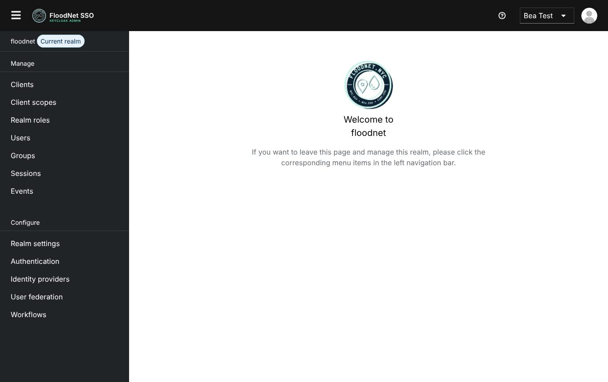

# FloodNet Keycloakify theme (draft)

An experimental replacement for the hand-written `floodnet/` FreeMarker theme,
built with [Keycloakify 11](https://keycloakify.dev).

All four theme types ship in one provider jar: **login** (same character as
the classic theme), **account** (its own character: warm paper, floating ink
rail, serif headings, no flood photo), **admin** (stock console, FloodNet
logo and colours only) and **email** (the restyled FreeMarker layout). The
classic `floodnet/` folder at the repo root is kept as v1 for rollback; this
project does not read from it.

## Login

Same FloodNet look as the classic theme, rebuilt on Keycloakify's maintained
pages with realtime validation and responsive sizing.

| Desktop | Mobile |
| --- | --- |
|  |  |


## Account

A deliberate contrast to the login page: warm paper canvas, a floating ink
navigation rail, mint accents and large serif headings. The Keycloak account UI
is kept intact and re-skinned.


## Admin

The stock Keycloak admin console with minimal branding: the masthead logo and
dashboard icon (`src/admin/assets/logo.svg`, `icon.svg`) and PatternFly brand
tokens (`src/admin/floodnet.css`). Everything else is upstream, so a Keycloak
upgrade is a version bump of `@keycloakify/keycloak-admin-ui`.

The account console shows an **Admin console** link in its masthead to
members of `/server-admin` (`ADMIN_GROUP_PATHS` in
`src/account/root/Header.tsx`). The account token carries no
realm-management roles, so the check reads the user's groups from the account
API. That needs the `account` client's `view-groups` role, which Keycloak does
not grant by default: give it to the `server-admin` group in the realm config.
Without it the link stays hidden.



## Email

`src/email/` is Keycloak's native FreeMarker email theme
(`@keycloakify/email-native`). Only `html/template.ftl` (the layout) and
`resources/img/` are owned; every message template is upstream.

## Layout

```
src/login/KcPage.tsx              login entry point; Keycloakify's default pages
src/login/main.css                login skin (single stylesheet)
src/login/assets/                 flood photo + logomark

src/account/KcAccountUi.tsx       account entry point (owned) — imports the CSS
src/account/floodnet.css          account skin (single stylesheet)
src/account/components/page/Page.tsx   page header + content surface (owned)
src/account/root/PageNav.tsx      icon navigation rail (owned)
src/account/root/Header.tsx       FloodNet masthead + initials avatar (owned)
src/account/root/Root.tsx         routing/shell (owned, for scroll-spy id)
src/account/colorScheme.ts        fixed light identity (owned)

src/admin/KcAdminUi.tsx           admin entry point (owned) — title + CSS import
src/admin/floodnet.css            admin brand tokens only
src/admin/assets/logo.svg, icon.svg  FloodNet logo (owned)

src/email/html/template.ftl       email layout (owned)
src/email/resources/img/          email logomark

src/main.tsx                      login entry + dev-only page preview
vite.config.ts                    theme name, Keycloak version targets
```

The account theme uses Keycloakify's Single-Page account implementation, so it
copies the upstream account UI into `src/account/` on install. Files owned by
this repo are tracked; the rest are regenerated from
`@keycloakify/keycloak-account-ui` by `postinstall` (`keycloakify
sync-extensions`). Run `npx keycloakify own --path "account/<file>"` before
editing any other account file.

## Develop

```bash
npm install
npm run dev
# http://localhost:5173/?page=login.ftl
# http://localhost:5173/?page=register.ftl
# any Keycloak page id: login-otp.ftl, login-reset-password.ftl, error.ftl, ...
```

The login preview uses Keycloakify's mock `kcContext` and is stripped from
production builds. The account console needs a real Keycloak session, so it is
tested by building the jar and mounting it in Keycloak (see below).

## Build the jar

Needs a JDK and Maven on `PATH` (Keycloakify shells out to `mvn`):

```bash
npm run build-keycloak-theme
# -> dist_keycloak/floodnet-keycloak-theme.jar  (~13 MB, all four types)
```

`keycloakVersionTargets` in `vite.config.ts` is pinned to the
`all-other-versions` jar (covers Keycloak 26.x) and skips the 22–25 jar.

## Deploy

`keycloakify/Dockerfile` builds an image holding only
`/opt/keycloak/providers/floodnet-keycloak-theme.jar` (pushing a `v*` tag publishes it as
`ghcr.io/floodnet-nyc/floodnet-keycloakify-theme`). Copy the jar into
Keycloak's `providers/` directory, then select `floodnet` as the realm's
login, account, admin and email theme. Don't also mount the v1 `floodnet/`
folder theme: both are named `floodnet`.

```yaml
volumes:
  - ./keycloakify/dist_keycloak/floodnet-keycloak-theme.jar:/opt/keycloak/providers/floodnet-theme.jar
```

With a new provider jar, plain `kc.sh start` re-runs its build step at boot
(slower first start); an `--optimized` image would avoid that.

## Design notes

**Login.** The card deliberately copies the classic theme's glass recipe rather
than layering a new "card" on top: no border, no hairline, no box shadow, the
same two translucent gradients (`#076b24` → `#110037`, `#00adff` →
transparent) and `backdrop-filter: blur(6px)` over the flood photo. The logomark
lives inside the glass. Polish is limited to typography rhythm, responsive
sizing, focus states and consistent controls.

**Account.** It is intentionally light-only (dark mode is opted out in
`colorScheme.ts` / `early-color-scheme.js`): PatternFly's dark palette fights
the warm-paper design. The canvas uses CSS-only contour rings, not an image.
Navigation is a floating ink rail with an icon per destination and a mint active
state; content sits on a large paper card with serif headings.

## Notes / next steps

- Welcome page: not themed. Redirect the auth root to the account console at
  the proxy instead (`/` → `/realms/<realm>/account/`).
- Keycloak 26.8 runs in iot-platform; the newest admin/account UI packages are
  26.7 (`260700.*`). Bump them when 26.8 builds are published.
- The jar is ~13 MB. In a local Keycloak 26.8 test it added about 10 MB of
  resident memory after loading login, account and admin pages.
