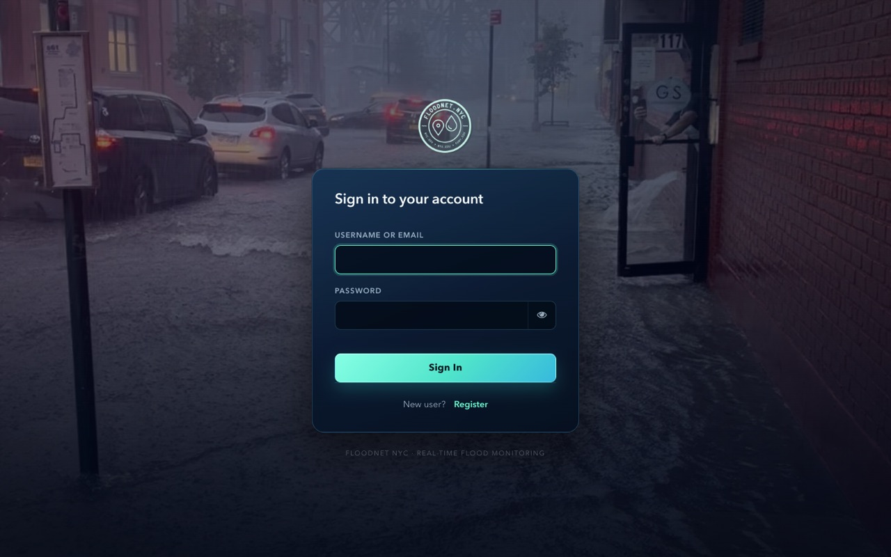
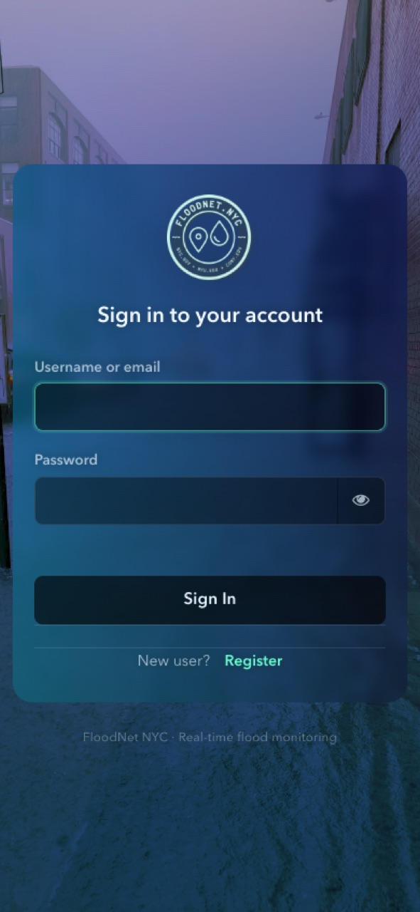
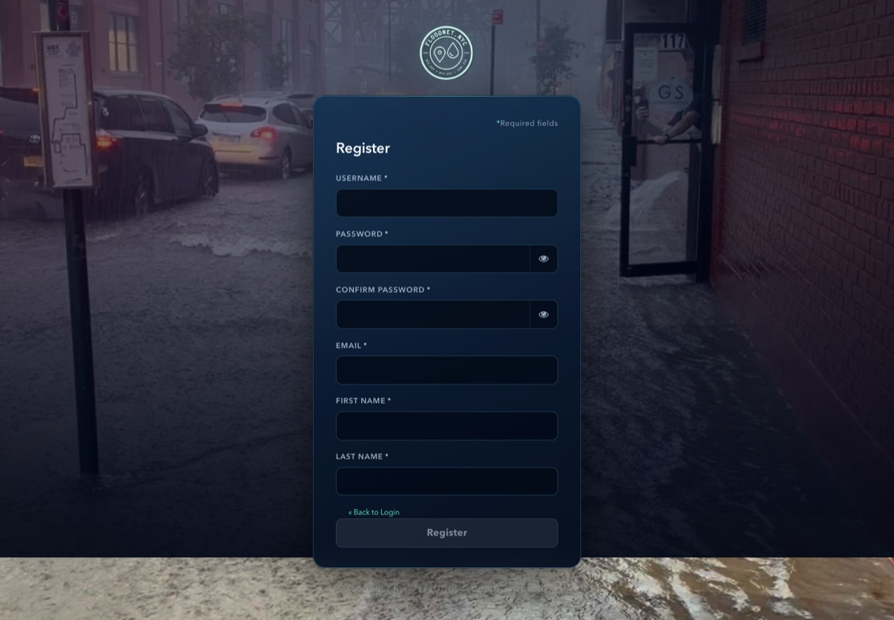
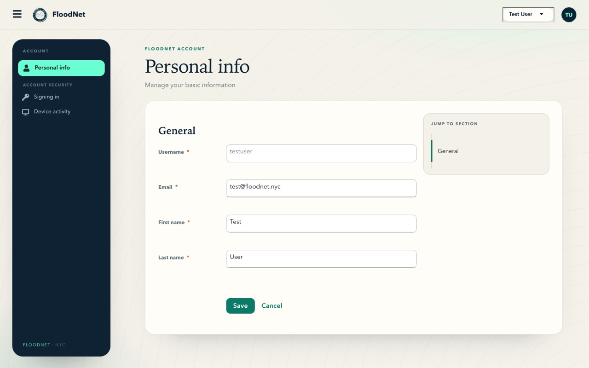
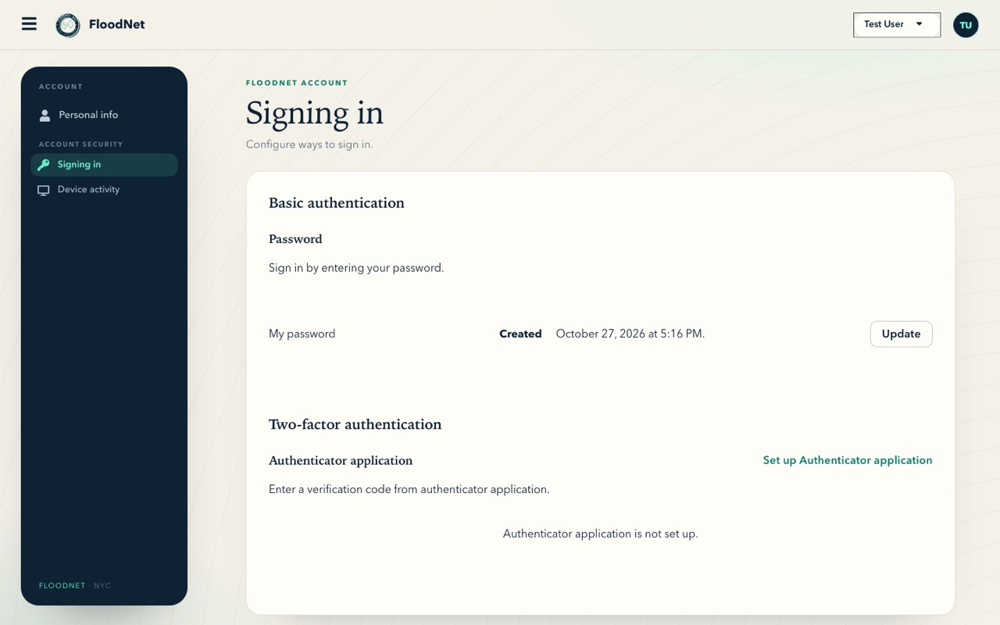
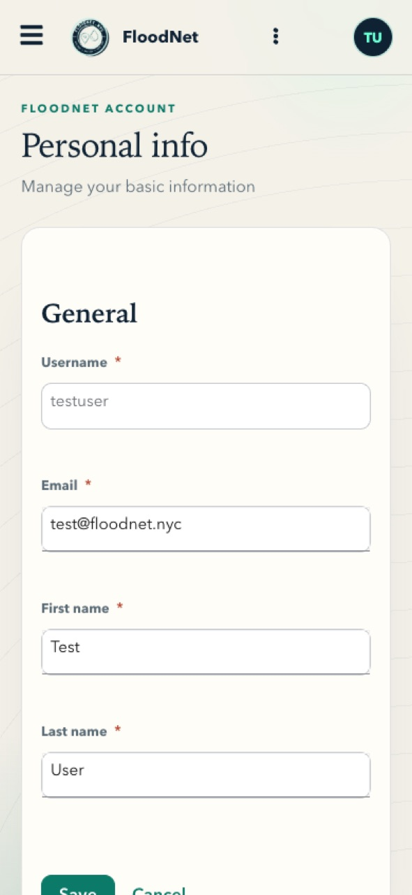

# FloodNet Keycloakify theme (draft)

An experimental replacement for the hand-written `floodnet/` FreeMarker theme,
built with [Keycloakify 11](https://keycloakify.dev).

Two theme types are ported so far: **login** (same character as the current
theme) and **account** (its own character — warm paper, floating ink rail,
serif headings, no flood photo). The admin console and email templates still
come from the classic `floodnet/` theme.

## Login

Same FloodNet look as the classic theme, rebuilt on Keycloakify's maintained
pages with realtime validation and responsive sizing.

| Desktop | Mobile |
| --- | --- |
|  |  |



## Account

A deliberate contrast to the login page: warm paper canvas, a floating ink
navigation rail, mint accents and large serif headings. The Keycloak account UI
is kept intact and re-skinned.







## Layout

```
src/login/KcPage.tsx              login entry point; Keycloakify's default pages
src/login/main.css                login skin (single stylesheet)
src/login/assets/                 flood photo + logomark

src/account/KcAccountUi.tsx       account entry point (owned) — imports the CSS
src/account/floodnet.css          account skin (single stylesheet)
src/account/components/page/Page.tsx   page header + content surface (owned)
src/account/root/PageNav.tsx      icon navigation rail (owned)
src/account/root/Header.tsx       FloodNet masthead + initials avatar (owned)
src/account/root/Root.tsx         routing/shell (owned, for scroll-spy id)
src/account/colorScheme.ts        fixed light identity (owned)

src/main.tsx                      login entry + dev-only page preview
vite.config.ts                    theme name, Keycloak version targets
```

The account theme uses Keycloakify's Single-Page account implementation, so it
copies the upstream account UI into `src/account/` on install. Files owned by
this repo are tracked; the rest are regenerated from
`@keycloakify/keycloak-account-ui` by `postinstall` (`keycloakify
sync-extensions`). Run `npx keycloakify own --path "account/<file>"` before
editing any other account file.

## Develop

```bash
npm install
npm run dev
# http://localhost:5173/?page=login.ftl
# http://localhost:5173/?page=register.ftl
# any Keycloak page id: login-otp.ftl, login-reset-password.ftl, error.ftl, ...
```

The login preview uses Keycloakify's mock `kcContext` and is stripped from
production builds. The account console needs a real Keycloak session, so it is
tested by building the jar and mounting it in Keycloak (see below).

## Build the jar

Needs a JDK and Maven on `PATH` (Keycloakify shells out to `mvn`):

```bash
npm run build-keycloak-theme
# -> dist_keycloak/floodnet-keycloak-theme.jar  (~5.6 MB, login + account)
```

`keycloakVersionTargets` in `vite.config.ts` is pinned to the
`all-other-versions` jar (covers Keycloak 26.x) and skips the 22–25 jar.

## Deploy

Mount the jar into Keycloak, then select `floodnet` as the realm's **login and
account theme** (Realm settings → Themes, or `kcadm.sh update
realms/<realm> -s loginTheme=floodnet -s accountTheme=floodnet`).

```yaml
volumes:
  - ./keycloakify/dist_keycloak/floodnet-keycloak-theme.jar:/opt/keycloak/providers/floodnet-theme.jar
```

Do **not** set `KC_SPI_THEME_DEFAULT=floodnet`: this theme ships only the login
and account types, so Keycloak would also try to resolve the admin/email themes
from it and fail.

## Design notes

**Login.** The card deliberately copies the classic theme's glass recipe rather
than layering a new "card" on top: no border, no hairline, no box shadow, the
same two translucent gradients (`#076b24` → `#110037`, `#00adff` →
transparent) and `backdrop-filter: blur(6px)` over the flood photo. The logomark
lives inside the glass. Polish is limited to typography rhythm, responsive
sizing, focus states and consistent controls.

**Account.** It is intentionally light-only (dark mode is opted out in
`colorScheme.ts` / `early-color-scheme.js`): PatternFly's dark palette fights
the warm-paper design. The canvas uses CSS-only contour rings, not an image.
Navigation is a floating ink rail with an icon per destination and a mint active
state; content sits on a large paper card with serif headings.

## Notes / next steps

- Admin console and email themes are not ported yet.
- The account theme adds the upstream account UI bundle (~440 kB) and the
  jar grows to ~5.6 MB.
- If you want to stay on the classic FTL theme, the same login polish is
  achievable in ~100 lines of CSS; Keycloakify's payoff is the maintained page
  set, realtime validation and the account theme.
